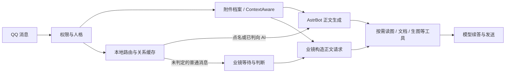

# 当前群聊架构审查

后续实施：已在 1.12.0 调整本文所述的近期资料交付、正文入口、任务记录和状态清理，见[统一上下文架构与验收](shared-context-architecture-2026-11-01.md)。下文保留审查当时的基线和发现。

审查基线：线上本地扩展 1.11.9、AstrBot 4.29.1、受管 ContextAware 3.11.0；两个现有允许群。仅只读线上配置和已有日志，在禁网临时容器使用合成消息复现。没有改动运行服务、没有模型调用、没有重放真实历史或发送 QQ。

## 结论

存在需要调整的架构问题，不能继续将实际体验问题主要归因于模型理解或网络延迟。平台连接、生图执行、持久附件和权限隔离可以保留；主要偏差在“观察到哪些资料、怎样提供给正文模型、谁决定本轮完成”之间的接口。

当前是一个带多种上下文视图的 Agent 接入系统，还不是完整的群聊多模态工作记忆和多人任务调度系统。ContextAware 没有与万象画卷同时生成图片的职责冲突；问题也不是通过换一个人格或再加一层语义规则就能解决。

## 已确认发现

| 优先级 | 问题 | 可见影响 | 证据 |
| --- | --- | --- | --- |
| P1 | 近期历史图片也只给目录，且“自动附图”配置不作用于当前后端 | 用户先发图后发文字，正文模型初始没有图片，必须再自主调用读图工具；漏调就无法解读 | `context_runtime.py:85` 硬编码 `image_recall_auto=False`；`264` 只直接附加本条消息/引用的图片；同配置原生隔离复现：ContextAware 候选图 1、直接图片 0，本地后端直接图片 1 |
| P1 | 本地路由和业镜使用两套入口、上下文和正文任务表述 | 同一请求能否直达正文、是否等群聊静默、最终被当作任务还是闲聊，取决于先走哪条路径 | `reply_routing.py:185` 接收纯文本元数据，`223–228` 的能力前置门只特殊承认表情请求；“纯图片→我让你解读一下图片”在冷上下文跳过本地判断，交给业镜。实际 16:36 业镜判断应答后，正文只发等待句，无工具调用 |
| P2 | 多份上下文视图独立裁剪，旧提示与新功能矛盾 | 一层说可从历史读取，另一层仍要求引用/重发，且模型面对的聊天窗口与判断器不同 | 路由器最多 40 条、判断器实际 12 条/3600 字；ContextAware 活跃历史 40 条、事实展示窗口 12 条；正文历史保留 12 个 user 角色轮次；`performance_context.py:30` 保留“请引用或重发原图”占位符。合成历史中确认此提示仍会产生 |
| P2 | 最近任务状态是群级单槽，不是独立任务集合 | 多人可以参与同一段近期聊天，但 A、B 各自提出任务后，前一个任务不再是路由器的活动锚点 | `reply_routing.py:52` 中 `last_ai` 和 `image_turn` 为单值；`note_ai` 在 `92` 覆盖原值。合成复现 A 待处理锚点被 B 待处理锚点覆盖；不等于原消息或图片已从档案删除 |
| P2 | 新增读图诊断字段未随请求视图一起清理 | 业镜复用源事件时，后一次请求可能显示旧候选统计或旧“已读图”数量，误导排障 | `context_runtime.py:175` 清理列表没有 `qq_context_catalog_stats`、`qq_context_images_viewed`。隔离事件清理后两个字段仍保留；不据此断言它们已经造成新一条真实回复错误 |

P1 表示优先修正的体验/架构问题，并非数据泄露或模型接口故障。表中的代码位置按本次基线记录。

### 图片目录不是多模态输入

多模态模型可以直接理解图片，前提是请求包含实际图像输入。当前策略把多数近期图片都转成“来源目录→模型选择工具→获得像素→再次推理”的路径。它有减少无关图片输入的合理目的，但作为所有历史图片的默认路径不符合用户希望的自然看群聊体验，并增加任务成功所需的模型工具决策步骤。

在正文请求中出现 `image_count=0` 既不能证明聊天记录完全缺失，也不能证明模型已经看到图片。应分别记录候选资料、初始像素、工具读取和最终采用的参考资料。

### 两套入口不是每条消息调用两遍判断

已有 `single_judge` 去重，不能把双入口错误描述为每条消息都做两次模型判断。问题是前置过滤、观察窗口、等待策略和正文任务提示不一致。16:36 的请求是本地过滤后由业镜判断一次，再启动主模型；业镜“自然接一句”的提示没有被入口本身区分为具体读图任务。

1.11.9 的统一任务完成提示能改善这种冲突，3 次合成模型选择检查也已通过，但属于提示层修正，没有改变默认无历史像素输入或双入口的架构。这不等于真实群聊的任务完成率已经得到验证。

### 测试通过的含义需要收紧

此前 181 项回归主要证明范围隔离、精确图片传递、工具执行、生命周期和异常预算等机制；合成模型探针只覆盖有限的工具选择问题。它们不证明真实模型在完整历史、多人插话、多张图和双入口组合下都能完成任务。因此不能再用机制回归数量替代真实连续场景的行为验收。

## 当前链路与延迟判断

16:36 样本接收到发送约 11.566 秒：业镜等待约 5 秒，判断模型约 3.257 秒，正文模型约 2.688 秒，上下文准备约 5.1 毫秒。该样本没有实际读图工具调用，不能据此估算正确完成读图任务的耗时，也不能推广为线上 p95。

“本地准备很快”不等于“业务架构没有增加延迟”。静默等待、采用何种判断入口，以及按需读图引入的后续模型轮次，均受业务设计影响。模型接口本身的耗时与业务选择调用几轮模型，应分开统计。之前把延迟主要归于模型的表述不够完整。

## 建议的目标架构

保留 SnowLuma、AstrBot、User Policy、万象画卷、LivingMemory 和表情包管理器；ContextAware 保留为近期消息、图片索引和按需回看的组件，不需要为此次问题换掉全部插件。

1. **一个事实入口，分出受控视图。** 接收时规范化消息 ID、时间、群/成员、回复关系及附件位置，原始事件保持不变。各使用方从同一事实档案生成视图，并沿用现有群/成员/人格权限；统一事实来源不意味着合并原本隔离的人格记忆。
2. **近处直接看，远处按需取。** 在输入预算内，把近期少量图片的视觉预览随对应消息传入正文模型，保留来源和发言者映射；模型据此决定语义关联及选用哪些参考图。更早的图、超预算图片、小字细节和文件全文走现有按需工具。原图仍供万象画卷使用，预览不冒充编辑原图。不以关键词规则猜中唯一目标，不把所有历史图片无上限上传。
3. **一个正文请求组装器。** 本地点名、语义判断及业镜只决定发言权、时机和触发原因；都交给同一个上下文/人格/工具组装入口。闲聊长度偏好不能覆盖具体任务。保留群友发言和实际工具权限边界，不把整个历史升级为系统指令。
4. **逐步统一触发决策。** 明确 @ 可直达正文；未明确指向 AI 的消息使用一份带附件元数据的有限视图作判断。业镜保留调度和主动参与能力，避免两个各自维护近期事实与任务解释的裁决体系。合并判断不能靠关闭另一套功能然后丢掉普通群聊。
5. **任务按 request_id 记录。** 区分待处理、执行中、已发送、失败、取消；记录发起者、来源消息、选用素材与发送结果。语义上是否属于同一任务仍由模型判断，程序负责保存和执行状态。不能让另一个人的新请求静默覆盖未完成任务。
6. **统一预算与可观测性。** 配置明确适用于哪个后端；保留原图容量、隔离与超时控制。分阶段记录排队、判定、上下文、初始图像、模型调用、工具和实际发送。修复请求状态清理，并消除旧“要求重发”的提示。

建议先做第 2、3 项及诊断清理，解决近期图像交付和任务完成的主要断点；再合并路由事实视图、补任务状态。暂不为了“智能”增加新的规划/摘要模型，也不通过对每种场景再加一条特例去替代上述调整。

## 后续验收门槛

使用固定的合成多模态会话，分别通过 @ 与主动接话两个入口验证：先图后文字、同人多段、多人补充、两张不同视角联合参考、新图覆盖旧任务、引用历史图、人格隔离、两个并发任务、工具失败及只有等待话术的结束情况。判断不仅看接口是否成功，还看初始是否提供正确像素、模型是否选全资料、正文是否实际回答、是否发送并保留正确结果。

每种场景记录入口、候选及实际图片来源、模型调用次数、首条实质回复时间和总耗时；同一模型与同一组样本比较前后，避免把更换模型或冷启动误算成架构收益。初期可给近期上下文明确可调的图片/尺寸/字数预算，具体数值由上述对照测试决定，不能仅凭本次本地毫秒级测试承诺总延迟下降。

## 复现方式与当前边界

`python scripts/evaluate-context-runtime.py --architecture-audit`：读取现有容器镜像标识，运行禁止联网、只读代码挂载和 tmpfs 临时数据的独立容器。实际生产数据卷不挂载。结果保存到忽略的 `logs/context-architecture-audit.json`。

1.12.0 实施后，该命令已更新为修复后的架构回归检查，验证图片直接提供、状态清理和任务保留；不再预期命中下面描述的旧版缺陷。旧版6项结果是本次审查时的历史记录。

本次 6 个架构复现检查均命中，其中第一个问题包含两个后端的行为对照。报告中的 `passed=true` 仅表示复现脚本按预期执行且问题被确认，不表示架构健康或问题已修复。本次线上仍为 1.11.9；新增的是审查文档和隔离诊断脚本，没有进行架构改造、服务重载或真实聊天补答。
