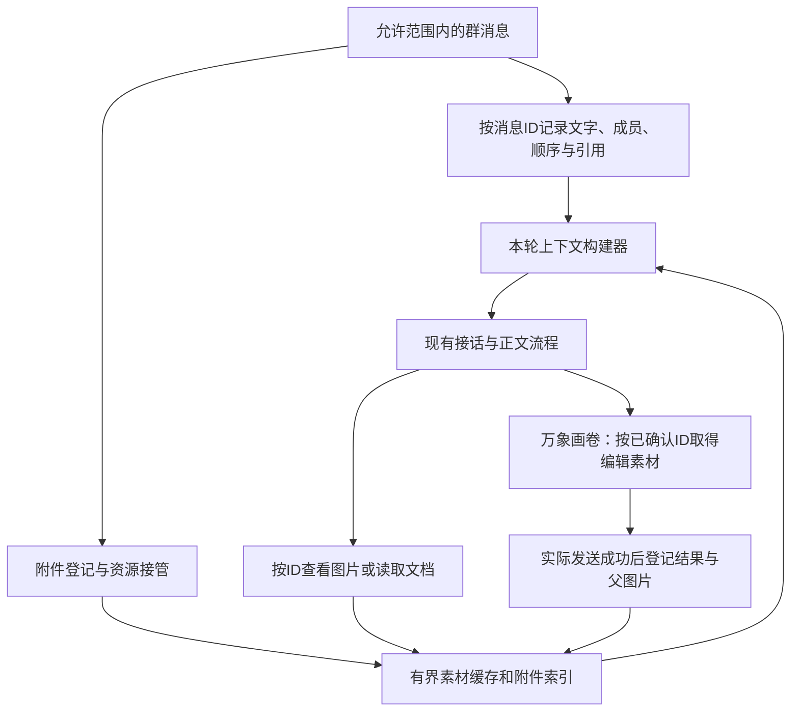

# 群聊消息与附件上下文优化方案

日期：2026-10-25（北京时间）。状态：研究与设计，尚未实施本方案；当前运行版本仍为本地插件 1.7.3。

## 结论

建议保留 SnowLuma、AstrBot、User Policy、SelfReply、LivingMemory 和万象画卷，在现有本地扩展内建立统一的消息与附件层。采用“记录全部允许范围内的消息、独立保管附件、近期明确对象直接附加、复杂指代由主模型按 ID 读取”的方案，逐步替换目前的分散缓存与关键词补丁。

不直接叠加另一套接话与记忆系统，也不默认对群里每张图片额外调用描述模型。ContextAware 是最贴近问题的社区参考，其缓存、来源追踪与公开接口值得借鉴；其现有生图桥接针对 Gitee AI Image，不能视为已支持我们的万象画卷。以下是结合官方资料、作者实现与本地代码提出的设计，不代表社区统一标准或官方对我们组合的兼容认证。

## 调研依据

| 一手来源 | 已核实的做法 | 对我们的意义 |
| --- | --- | --- |
| [AstrBot 官方配置说明](https://docs.astrbot.app/dev/astrbot-config.html#provider-ltm-settings) | 群聊记录可注入上下文；自动图片转述是独立开关，官方提示会增加调用和 token 开销 | 可以保留群聊观察，但不能把图片转述默认全开当作低延迟修复 |
| [AstrBot 4.29.1 消息历史源码](https://raw.githubusercontent.com/AstrBotDevs/AstrBot/v4.29.1/astrbot/core/platform_message_history_mgr.py) | `insert_message_chain` 将图片、音频、视频、文件转为占位记录；保留文字、@ 和部分引用资料 | 原生群消息表可复用作记录来源之一，但不是可恢复全部附件的素材库 |
| [ContextAware 作者说明](https://raw.githubusercontent.com/muyouzhi6/astrbot_plugin_context_aware/main/README.md) | 非触发消息也可进入图片目录，简单近图直接附加，复杂情况按图片 ID 回看；有独立容量和时效控制 | 图片索引应独立于文本窗口，超过自动承接时间不应立即变成完全不可查 |
| [ContextAware 图片缓存实现](https://raw.githubusercontent.com/muyouzhi6/astrbot_plugin_context_aware/main/image_context.py) | 明确处理资源接管、请求快照、清空代际、并发和淘汰 | 必须测试消息结束、缓存淘汰和并发任务，而不只测试目录里有一条路径 |
| [ContextAware 图片交接接口](https://raw.githubusercontent.com/muyouzhi6/astrbot_plugin_context_aware/main/image_reference_api.py) | 按本轮目录校验图片 ID，并按组交付素材；任务与生成结果有来源关系 | 视觉查看与实际改图必须引用同一个受控附件对象，缺一张就不能偷偷省略 |
| [Group Chat Plus 作者工作流](https://github.com/Him666233/astrbot_plugin_group_chat_plus/blob/main/docs/MESSAGE_WORKFLOW.md) | 区分多模态直传、转文字及消息元数据；部分媒体仅保留路径/占位 | 可参考消息组织方式，但不能因此假设历史文件正文和图像都已进入模型 |
| [OpenAI 官方图片输入](https://developers.openai.com/api/docs/guides/images-vision) | 模型需要实际图像输入；多图会占用输入预算 | 附件名称、路径或描述不能替代真实图片；每轮选相关图，控制视觉输入 |
| [OpenAI 官方文件输入](https://developers.openai.com/api/docs/guides/file-inputs) | 文件能力随端点不同；Chat Completions 的原生文件输入有限，应用可自行提取文字 | 我们经 LiteLLM/CLIProxy 的能力要单独验收，优先采用可跨模型复用的本地解析 |

以上页面于本次研究时访问。GitHub 默认分支可能变化；实施若复用第三方代码，需要锁定经过检查的版本并保留其许可证，不能把在线 README 当作当前部署已经具有的能力。

OpenAI 另有[托管文件检索](https://developers.openai.com/api/docs/guides/tools-file-search)，说明长文件可以走检索而非每轮全文输入。本方案采用本地检索，不假设现有中转已经支持该托管工具，也不计划为此迁移模型端点。

## 当前缺口与取舍

已核对本机 AstrBot 4.29.1、本地扩展 1.7.3、User Policy v3.5.6、SelfReply 1.5.1、LivingMemory 2.7.1、万象画卷 3.3.23。当前未安装 ContextAware 或 Group Chat Plus。

- 本地消息快照主要保存文字；原有旧对话检索也只索引文字，不包含通用附件索引。
- 1.7.3 保存每位成员最近一次上传，以 180 秒窗口承接部分后续表达；多次独立发图、跨成员明确指代、较旧附件及文档仍缺少统一查询路径。
- 图片消息可以包含本地路径或临时来源，记录路径不等于已经取得长期有效的资源所有权。
- 当前版本预处理会将图片来源规范化为本地路径，并对规范化图片解除事件临时文件跟踪。因此不能断言本机所有图都会在消息结束时删除；但路径也可能被其他清理器删除，升级和异步任务还会改变生命周期。仍需受控接管和实际清理测试。[原生事件资源接口](https://raw.githubusercontent.com/AstrBotDevs/AstrBot/v4.29.1/astrbot/core/platform/astr_message_event.py)、[预处理实现](https://raw.githubusercontent.com/AstrBotDevs/AstrBot/v4.29.1/astrbot/core/pipeline/preprocess_stage/stage.py)提供了核查依据。

| 候选方案 | 取舍 |
| --- | --- |
| 只增大文字上下文或继续延长 180 秒窗口 | 无法补回没有保存的像素和文件内容，不选 |
| 全量开启图片自动转述 | 对普通图片增加模型调用；文字描述不能提供可靠改图源，不作为默认方案 |
| 整体切换 Group Chat Plus | 同时涉及回复调度、上下文和记忆，迁移面过大，不作为这轮优化 |
| 直接安装完整 ContextAware | 图片回看方向合适，但与人格隔离、既有注入及万象画卷的组合尚未验证，不能当作即插即用 |
| 在现有扩展内统一消息/附件接口，参考或复用经过隔离验证的社区模块 | **推荐**；保留运行行为，集中修复附件生命周期与读取链路，减少后续重复补丁 |

## 目标结构

### 1. 完整事件记录与稳定附件 ID

在现有允许群范围内，即使没有触发回复，也登记新收到的消息。统一字段包含平台实例、群/会话、平台消息 ID、发送者、接收顺序、平台时间（缺失时标记未知）、文字、@、引用 ID、附件列表及策略可见范围。

附件记录独立保存类型、文件名、MIME、大小、来源消息、消息内位置、内容哈希及状态：`pending / ready / failed / expired / evicted / unsupported`。本地路径和下载凭据只留在内部，不作为模型可执行的文件地址。

同一成员连续发两条图时保留两个事件，不再覆盖为“最后一张”。重复消息按平台实例、会话和消息 ID 去重；不按相同文字擅自删除用户的重复发言。先复用已存在的可靠原生记录与本地索引，附件侧表补齐其缺失字段，不建设第二套完整机器人平台。

### 2. 在消息生命周期内取得素材

本地临时附件在事件结束前复制到扩展管理的缓存，或通过已验证的所有权转移接口接管。通过线程 I/O 完成，不调用图像描述模型。来自远端的有效来源可后台预取，记录失败状态和短时退避；不让排队无限增长。

缓存中区分接收源副本和视觉预览副本。视觉预览可以缩放，改图使用与所选附件对应的高质量源副本；如果框架在收到前已转码，记录这一事实，不承诺字节等同用户上传原文件。过期后仍可保留来源元数据，但必须显示内容不可用，不能伪装成仍可读取。

### 3. 一个上下文构建入口

近期文字、附件目录、真实图片、文档摘录和任务状态统一组装，给内容标记来源和有效性。人格提示词继续使用现有配置，群聊原文、附件和 OCR 结果均作为引用资料，不提升为系统指令。

避免同时注入原生群聊全文、本地快照和新目录的重复内容。对已有可靠消息 ID 的记录去重；缺 ID 的旧历史不按文本猜测删除。保留现有 12 轮 AI 对话、历史检索和长期记忆，首先控制新增目录预算，不先扩大所有输入窗口。

本轮开始时冻结可见消息与附件目录。生成过程中才到的新图属于后续事件，不得突然成为当前编辑的参考图。

### 4. 附件选择与读取

默认次序为当前明确附件/引用、已确认任务的明确附件 ID、近期上下文中的候选。若当前附件与引用承担不同用途（例如新衣服图和旧人物图），保留两者的语义角色，不机械二选一。

同一成员刚发唯一相关图片，下一条明确针对它的要求，可直接附加图片，不再调用一个额外的选图模型。含糊、多图、其他成员的图或较旧对象，由主模型根据目录选择附件 ID；关键词只帮助提取候选，不作为是否允许读取的最终入口。

拟增加受控工具：

- `read_group_message(message_id)`：读取本范围内原消息、必要邻近发言和附件目录。
- `view_context_images(attachment_ids)`：返回真正进入视觉输入的图像内容，支持有限多图；不能只返回一个路径字符串。
- `read_context_document(attachment_id, query, page_or_range)`：读取文档摘录及页码/行号/单元格位置。

图片 ID 由本轮目录和权限校验，不接受模型任意指定本地路径。候选不足时读取更多本范围内历史；仍不能确定时澄清，不默认用全群最后一张。组内其他成员的公开消息可按明确指代读取，不冒充当前用户经历；跨群不读，成员独立策略仍按原权限执行。

### 5. 改图、生成结果与任务独立性

为图片工具增加明确的 `reference_ids`，逐步替换含糊的 `use_previous_reference`。每个 ID 可以标记主体、衣服、背景或风格用途。实际执行前冻结素材副本，校验全部引用来自本轮授权目录；任何必要参考缺失时停止，不能静默改成纯文生图。

模型看到的预览与生图模型使用的源图通过同一个附件 ID 和派生关系关联，不能要求二者缩放后的字节哈希相同。日志记录素材 ID、源哈希及预览关系，便于核对。

只有平台确认发送图片成功后才登记生成结果，记录请求 ID、平台消息 ID、请求者、父图片 ID 和发起顺序。慢任务晚完成不覆盖后来发起的任务；任务执行不依赖之后被清理的短期缓存。失败或发送未确认不登记为成功结果。

### 6. 文档与其他格式

首批支持 TXT/MD、文字型 PDF、DOCX、CSV/XLSX：在本地有界解析，缓存提取结果，按查询返回片段。PDF 保留页码；DOCX 保留段落/表格位置；表格保留工作表、表头与单元格范围。长文件按需检索，不每轮灌入全文，不默认增加 embedding 服务。

扫描 PDF、文档内图片或复杂图表按需要提供页图/OCR，并记录额外模型调用。暂未实现的格式登记为不支持，不假装已经读取。音视频先复用已经存在的转写结果，其余能力后续单独设计。

官方文件能力与我们经中转的 Chat Completions 能力不能画等号。优先“本地提取文字/页图 → 当前模型”，端点原生文件上传作为通过合成文件验收后的可选路径；不为了读取文档顺便迁移 Sol 协议。

## 初始预算与时延目标

以下全部是**建议值和验收目标，尚未实测，不是官方默认或性能承诺**。

| 项目 | 起始建议 |
| --- | --- |
| 新增群消息索引 | 每群最多 5000 条或 7 天，先到上限者清理；不改变现有长期记忆保留策略 |
| 近期文字 | 先维持现有窗口，统一来源并去重后再评估扩大 |
| 本轮附件目录 | 最近约 20 项，紧凑元数据预算约 1200 字符；更早对象可检索 |
| 自动承接 | 保留 180 秒，但只是“直接附加”条件，不作为附件唯一存活时间 |
| 图片缓存 | 热目录 30 分钟，受控磁盘副本默认 24 小时；全局 512 MB、每群 128 MB，达到限额可更早淘汰 |
| 每轮视觉输入 | 默认 1–2 张，可按明确比较/多参考请求扩展至 4 张并受总大小限制 |
| 远端预取 | 最多 2 并发、16 个待处理任务；缓存未就绪不增加统一固定等待 |
| 单文件处理 | 初始 20 MB 上限，文档提取有页数/字符预算，超出按范围读取 |
| 自动图片转述 | 默认关闭，需要时开启且按内容哈希缓存与限额 |

普通文字路径只查询本地元数据，**目标不新增模型调用**，新增本地准备耗时 p95 目标不超过 200 ms；图片缓存命中目标不超过 500 ms 的额外本地处理。均须在当前 Docker/WSL 数据卷上测量，达不到就调整写入方式、索引或目录大小。

简单新图直接进入现有主模型调用，不加独立识图前置请求，但视觉输入会增加主模型处理负担。复杂回看可能经过“主模型选择工具 → 读取图/文件 → 主模型继续”的一轮工具往返，这部分应明确计入时延。不能保证所有场景零延迟增加。

日志按 trace 分开记录 `event_record_ms`、`attachment_retain_ms`、`context_build_ms`、`attachment_read_ms`、缓存命中、来源 ID、模型等待和平台发送时间。性能面板展示来源可用性和读取失败原因，默认不打印文档正文、图片内容或下载凭据。

## 实施顺序与验收

1. **P0：消息与附件资源接管。**统一消息 ID、来源和缓存所有权，保留多次上传；添加真实预处理、文件清理和重启的测试。先解决“有消息记录但资源失效”。
2. **P1：上下文与改图使用同一附件 ID。**上线目录、有限自动附图、按需看图及万象画卷适配；灰度通过后停用旧分散承接逻辑，避免两套选择器同时生效。
3. **P2：文档解析与查询。**先文本和文字型文档，之后扫描/OCR及复杂表格；每类格式分别验收，不把图片回看完成当成文件功能完成。
4. **P3：可观测、开关与性能回归。**提供总开关、自动附图、按需读取、文档解析和可选转述开关。关闭扩展后保留原生当前消息附件行为，已有缓存按策略清理，不清空真实对话。

先在隔离实例使用合成材料；如评估直接复用 ContextAware，检查锁定版本及其公开接口、User Policy 隔离和回调顺序，关闭重复的场景注入/摘要，只保留经过验收的职责。验证未通过时不直接加载到生产。现有 Docker Compose 服务结构无需预先扩充。

关键验收案例：新照片与旧角色同场、多次独立上传后分别指代、A 发图 B 明确提问、多人图片歧义、两图混合参考、明确引用旧图、引用机器人生成图继续编辑、收图事件结束后读取、临时文件被删、重载/重启、reset/new、人格切换和成员独立策略、并发晚完成、缺一张参考、引用文档后提问及跨页查询。

验收必须检查**最终序列化给模型的请求**中实际存在图片内容，并检查生图接口实际取得的来源 ID 与像素关系；只证明缓存目录有一项、工具返回一段路径或模型口头说看到了都不算通过。先用替代 Provider/生图/发送器测试真实 runner 链路，再针对现有两条模型路由用合成材料做有限端到端验收，最后仅在测试群灰度。

回滚按新附件层开关进行，保留 1.7.3 行为和数据库备份；新增索引/缓存独立于真实聊天历史，不以删除会话作为回滚手段。方案不包含现在就更换模型、安装整套群聊插件、开启全群转述或批量重放历史附件。
