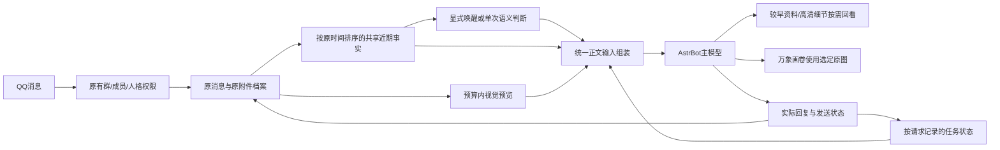

# 1.12.0 统一近期多模态上下文

本次落实[架构审查](architecture-audit-2026-11-01.md)中的主要问题。保留 SnowLuma、AstrBot、User Policy、ContextAware、万象画卷、长期记忆和表情包插件。新增的是统一请求组装与任务记录，没有另建选图或摘要模型。

## 消息与资料如何流动

近期事实取自同一权限范围的原消息档案，包含发言者、原时间、引用与 @ 关系、纯图片消息和附件来源。正文模型与本地判断器使用这个事实来源，各有输入预算。按原时间排序，补收旧消息不会冒充刚发生的消息；每轮仍冻结消息序号边界，避免混入生成开始后的新发言。

### 图片直接输入与按需回看

两个后端统一使用 `RequestContextCompiler`：近期预算内的图片直接作为原生多模态内容交给当前主模型，不要求模型先调用读图工具，也不要求用户引用。默认最多 4 张历史图片预览、最长边 1024 像素、总 JPEG 字节 1 MiB。候选来自预算内消息，不用关键词规则猜一个语义目标；模型自行根据实际图像、成员与来源判断关联。

当前消息及明确引用的原生附件沿用原有路径，不伪装成其他用户刚上传的图片。历史预览带独立来源 ID，生成工具仍根据模型选定的完整 ID 集合冻结并使用原始文件，预览不替代编辑原图。较早图片、超出预算的内容和不清晰细节继续使用历史及读图工具；大文档仍按需读取，不无上限附加全文。

事实副本与图片预览使用 AstrBot 原生 `mark_as_temp()`，参与本轮模型输入，不重复保存到正式会话。原始群消息、原图档案和模型实际回复仍保留。缓存按原图摘要和预览尺寸复用，内存上限约 16 MiB、最多 64 项。

ContextAware 继续负责受管图片索引、来源目录和读图。共享模式通过其公开图片目录 API 冻结来源，不再同时执行它的另一套场景写入与自动选图。用户消息不被本地代码改写成推测任务。

## 统一触发和任务含义

- 显式 @/唤醒保持直接进入正文；空 @ 通过原生请求占位越过空消息检查，原始 QQ 消息不变，模型依据上下文决定承接或自然回应。
- 已获共享事实的非命令消息走本地语义判断，不再因“没有旧 AI 锚点”直接过滤。判断器能看到附件元数据；纯图片续话、简短确认也可结合上下文判断。它不负责识图，实际视觉内容由正文模型理解。
- 已完成本地判断的消息沿用 `single_judge` 防止业镜再次判断；明确沉默或发言对象是群友时不转成强制回复。每用户间隔、判断并发、超时与失败退避继续保留。
- 业镜保留调度和主动参与能力，但正文钩子将其“随口接一句”的临时任务替换为真实本条请求，并附同一个事实/预览输入。两个入口都遵守同一任务完成提示、人格与工具权限。

这意味着部分过去被本地过滤、再等业镜静默检查的普通消息，现在会直接作一次语义判断。密集群聊的判断频次可能上升，不能说所有流量下模型调用总量绝不增加；单条已判定消息不额外加第二轮判断或规划模型。明确唤醒无需这轮判断，较早资料仍可能需要工具后的模型续答。

## 多人任务与生命周期

每个实际正文请求按消息 ID 独立登记，保留发起者、请求、状态、图片执行结果及参考 ID。后来的请求不会删除其他成员的任务。少量近期任务状态也作为引用资料加入统一正文输入，语义上应承接哪项任务仍由模型判断。

原来的 `last_ai` 保留为兼容视图，多任务集合成为其他任务锚点的来源。正常发送只更新对应请求；错误、取消和无确认完成分别留状态，重启将原先 pending 标成 interrupted，不虚构后台仍在工作。人格/成员范围切换保留各自记录，在途旧人格结果不写进新人格任务。

这不是跨群自动后台任务队列，也没有新增长时间任务自动重试；实际生成与发送仍复用 AstrBot、业镜和万象画卷的运行器、权限及预算。

## 清理的遗留行为

清除旧历史裁剪中的“必须引用或重发”提示，统一说明先使用近期预览，缺少时再按来源回看。引用他人消息被视为资料关系，单独引用不再等同于明确要求另一个群友回答；实际 @ 他人仍保留原有收件人约束。

请求结束清理候选目录、已读图、事实和初始预览统计，避免业镜复用事件时继承上一轮状态。模型日志包装器重载时只清理自身代码的遗留包装层，不拆其他插件包装，防止一个实际调用被旧、新模块分别记账。原权限、原图精确冻结、失败预算及发送成功后登记均保留。

## 后台设置

AstrBot → 插件 → QQ 人格模型与回复条件 → 配置 → **统一消息与附件上下文**：

| 设置 | 作用 |
| --- | --- |
| 自动附图 `auto_attach` | 近期视觉预览总开关，两个后端均生效；关闭仍保留统一文字事实和按需工具 |
| 统一近期输入 `recent_input.messages` | 近期消息上限，默认 16，实际还受字符预算限制 |
| `chars` | 事实与近期任务资料预算，默认 6000 字符 |
| `max_images` | 直接提供的历史预览上限，默认 4，可设 0 |
| `max_edge` / `max_bytes` | 预览尺寸与总字节上限，默认 1024 / 1 MiB |
| `max_age_seconds` | 预览候选最长时间，默认 86400 秒，仍受原图保存期、容量和消息窗口约束 |

`on_demand_read` 控制较早资料和细节回看，不影响近期预览开关。旧 `auto_attach_seconds` 仅供旧独立附件接口兼容，当前统一路径使用 `recent_input` 的预算，不再表现为本地后端开启、ContextAware 无效。

如果实际群聊图片较多且回复变慢，可先将 `max_images` 降为 2 或 1；关闭 `auto_attach` 会退回目录加按需读取，模型可能需要更多工具轮次。这是延迟、资料覆盖和输入量的取舍，不承诺关闭就必定更快。

## 验收与耗时

184 项禁网原生回归、27 项架构场景检查，以及 56 项路由、24 项附件存储、4 项历史裁剪本地测试通过。包含两入口初始像素、两成员双图、自动预览开关、原生 Provider 接受 ContentPart、预览不持久化、空 @、人格隔离、引用来源、任务独立更新与重启状态、日志重载单次计数。原生生图执行测试使用替身 HTTP，验证实际参考字节及发送登记，不调用真实生图接口。

通过 `scripts/evaluate-unified-context-models.py`，使用 DeepSeek 1017 实际调用现有 API，提交由隔离原生组装器生成的合成图像与虚构群聊：

| 场景 | 初始图片 | 正文模型调用 | 最终一次测试耗时 | 结果 |
| --- | --- | --- | --- | --- |
| 单图直接提问 | 1 | 1 | 3.766 秒 | 直接答对颜色，无读图调用 |
| 同图主动回复入口 | 1 | 1 | 2.092 秒 | 直接答对颜色，无读图调用 |
| 两位成员各发一图 | 2 | 1 | 1.370 秒 | 分别答对两人的图像颜色 |
| 拼接两张历史图 | 2 | 1 | 2.850 秒 | 选择两张正确参考，任务参数校验通过 |
| 独立新图 | 2 | 1 | 2.129 秒 | 参考集合为空，未误用历史图 |

后两项只看工具决策，绝不执行工具或发送 QQ。没有重放真实用户历史；这组简单合成场景不代表真实复杂人物/三视图任务完成率或生产 p95。

最终本地准备基准：ContextAware 40 样本 p50 10.563 ms、p95 12.446 ms、首次 46.354 ms；本地后端 p95 14.227 ms。审查前一次合成基准 ContextAware p95 约 9.246 ms，测试运行存在波动，仅说明本地准备仍在毫秒量级，不能据此承诺整体回复几乎不受影响。模型处理额外图片仍有输入量和耗时；本次为模型直接提供资料，减少简单读图必须先调工具的流程依赖。

## 部署与回滚

通过 `scripts/deploy-shared-context-architecture.py` 在实际服务空闲时升级本地扩展及受管 ContextAware 适配器。只增加近期输入默认预算，保留原有群、成员、人格、Provider 绑定和图像 API 配置。文件和原配置均在同数据卷保留回滚备份；源文件散列、运行后端、实际预算、两群策略范围及原模型绑定均需通过验证。

部署后看日志 `request_context_compiled`、`request_ready.initial_history_images/preview_bytes`、`context_images_viewed`、`reply_done` 与发送完成记录，分别确认准备了什么、真正提供了多少图、是否额外读取和是否完成发送。后台状态同时展示实际预算。线上真实复杂群聊的行为仍需正常使用验证，测试通过不能替代这一边界。
